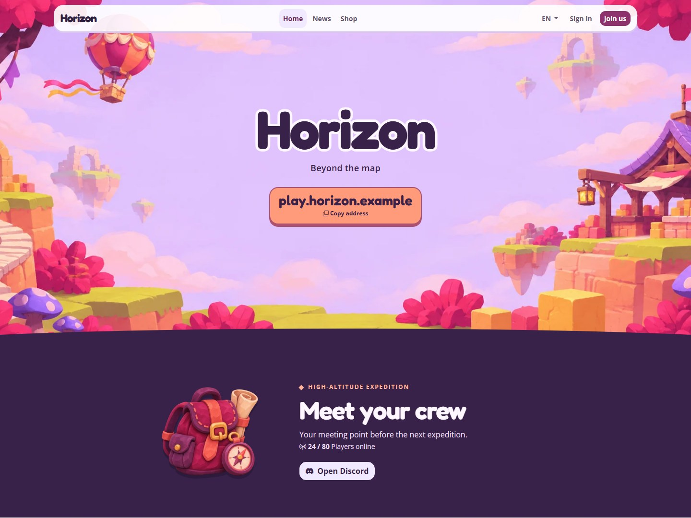

# Horizon for KraftInk

Horizon is an adventure theme for your KraftInk site. The homepage opens above floating plateaus in a pastel sky, then brings players together with quick access to the server and a logbook for your news.

## Set up Horizon

1. In KraftInk, open **Administration → Themes** and install Horizon from the catalogue or upload its ready-to-install ZIP.
2. Click **Use for website**.
3. Set your homepage heading in KraftInk and publish news to fill the logbook.
4. Add a public server address so players can copy it from the homepage. Add Discord or other social links to show them in the community section.

[KraftInk](https://kraftink.com/en) · [Theme installation guide](https://kraftink.com/en/documentation/extensions-catalogue) · [Discord](https://discord.kraftink.com)
